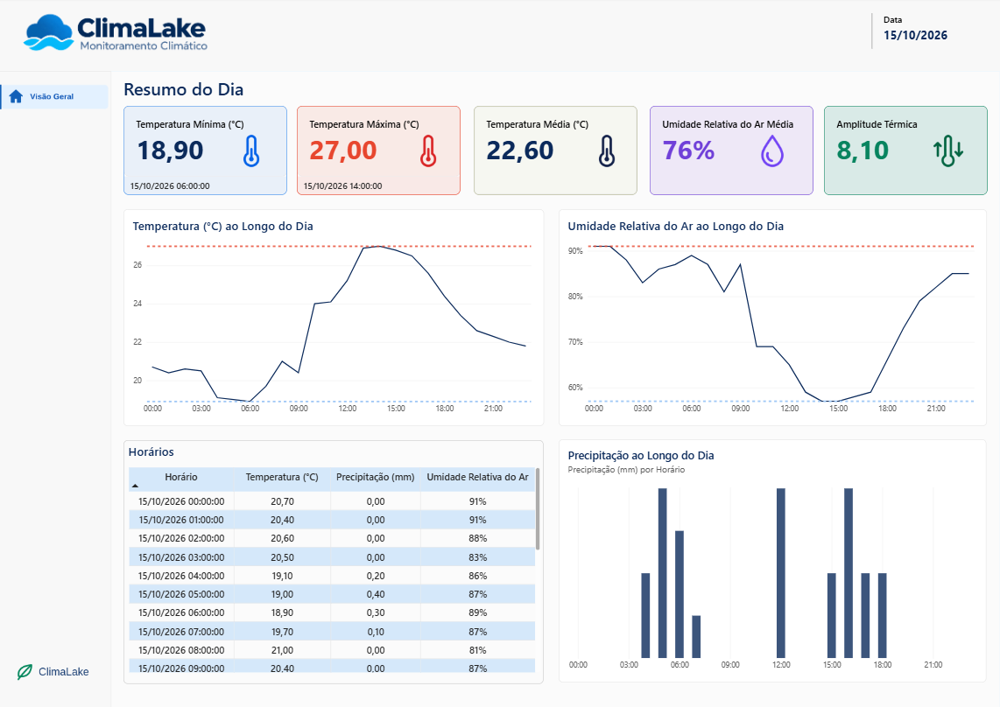
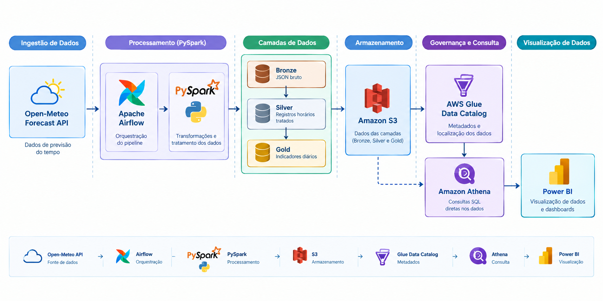

# ClimaLake 🌦️

Pipeline de dados meteorológicos desenvolvido para praticar **Engenharia de Dados** com **Python, PySpark, Apache Airflow e AWS**, utilizando a arquitetura medalhão **Bronze → Silver → Gold** e disponibilizando os dados para consulta analítica com **AWS Glue Data Catalog, Amazon Athena e Power BI**.

O projeto consulta a previsão meteorológica de **Belo Horizonte (MG)** na API pública [Open-Meteo](https://open-meteo.com/), armazena a resposta original no Amazon S3, transforma os registros com PySpark e gera indicadores diários, que podem ser visualizados por meio de um dashboard no Power BI. O Airflow coordena todas essas etapas por meio de uma DAG que, nesta versão, é **disparada manualmente**.

## Dashboard ClimaLake

O dashboard reúne indicadores diários e a evolução horária de temperatura, precipitação e umidade relativa do ar. A data de ingestão fica visível para facilitar o acompanhamento da atualização dos dados.



📥 [**Baixar o dashboard ClimaLake**](dashboard/ClimaLake.pbix)

### Indicadores apresentados

- Temperatura mínima, máxima e média do dia.
- Horários em que ocorreram as temperaturas mínima e máxima.
- Umidade relativa do ar mínima, máxima e média.
- Horários em que ocorreram os extremos da umidade relativa.
- Amplitude térmica, calculada como temperatura máxima - temperatura mínima.
- Data de ingestão (`ingestion_date`).
- Séries horárias e tabela detalhada com horário, temperatura, precipitação e umidade relativa.

## Arquitetura



O Airflow coordena a execução das etapas Bronze, Silver e Gold enquanto o PySpark realiza as transformações. O S3 armazena os arquivos, o AWS Glue Data Catalog registra os metadados das tabelas e o Athena consulta os dados usando SQL. O Power BI conecta-se ao Athena por meio do driver ODBC permitindo a atualização e visualização do dashboard.

## Camadas de dados

| Camada | Conteúdo | Exemplo de chave no S3 |
|---|---|---|
| **Bronze** | Resposta bruta da API, incluindo metadados e séries horárias retornadas. | `bronze/ingestion_date=AAAA-MM-DD/open_meteo_clima_AAAAMMDD.json` |
| **Silver** | Dados normalizados em registros por horário, com temperatura, precipitação e umidade relativa. | `silver/ingestion_date=AAAA-MM-DD/clima_silver_AAAAMMDD.parquet` |
| **Gold** | Indicadores agregados do dia, incluindo extremos, horários dos extremos, precipitação total, umidade e amplitude térmica. | `gold/ingestion_date=AAAA-MM-DD/clima_gold_AAAAMMDD.parquet` |

Os arquivos usam a partição `ingestion_date=AAAA-MM-DD`. Os nomes dos objetos são determinísticos por data de ingestão; uma nova execução no mesmo dia substitui objetos com as mesmas chaves. O versionamento do bucket S3 pode ser ativado para preservar versões anteriores.

Por que **JSON** na Bronze e **Parquet** na Silver e Gold?
A escolha dos formatos acompanha a finalidade de cada camada:
- **Bronze** — JSON: mantém a resposta original da API em um formato legível e próximo à fonte. Isso facilita auditoria, rastreabilidade e reprocessamento sem precisar chamar a API novamente, desde que o objeto original esteja disponível.
- **Silver** — Parquet: após a normalização, os dados passam a ter estrutura tabular e tipos definidos. O Parquet é um formato colunar que costuma compactar melhor e permite que mecanismos analíticos leiam apenas as colunas necessárias, em vez de percorrer todo o conteúdo textual de arquivos JSON.
- **Gold** — Parquet: os indicadores agregados também são dados tabulares e apropriados para consultas analíticas. O formato colunar favorece leituras eficientes no Athena e é adequado para tabelas consumidas por ferramentas de BI. Para o pequeno volume atual, a escolha é principalmente uma prática de arquitetura e preparação para expansão.

## Indicadores calculados na Gold

- **Temperatura mínima, máxima e média:** calculadas a partir dos valores horários.
- **Horários da temperatura mínima e máxima:** identificam quando os extremos ocorreram.
- **Precipitação total:** soma da precipitação horária retornada pela API para o dia.
- **Umidade relativa mínima, máxima e média:** calculadas a partir dos valores horários.
- **Horários da umidade mínima e máxima:** identificam quando os extremos ocorreram.
- **Amplitude térmica:** temperatura máxima menos temperatura mínima.

A Silver mantém um registro por horário; a Gold resume esses registros em indicadores diários. Como a consulta utiliza `forecast_days=1`, a implementação atual calcula os indicadores para o único dia consultado.

## Catálogo e consulta analítica: AWS Glue e Amazon Athena

O **AWS Glue Data Catalog** armazena os metadados necessários para que as ferramentas analíticas reconheçam as tabelas e suas estruturas, incluindo colunas, tipos e localização dos arquivos no S3. O banco de dados utilizado na configuração atual é `climalake`, no catálogo `AwsDataCatalog`.

O **Amazon Athena** permite consultar os dados diretamente no S3 usando SQL, sem precisar carregar os arquivos para um banco de dados tradicional. A configuração atual utiliza a região `us-east-1` e o workgroup `primary`.

### Exemplos de consultas

Listar as tabelas disponíveis no banco:

```sql
SHOW TABLES IN climalake;
```

Consultar uma amostra de uma tabela registrada no catálogo:

```sql
SELECT *
FROM climalake.nome_da_tabela
LIMIT 10;
```

Substitua `nome_da_tabela` por uma tabela existente no Glue Data Catalog.

## Tecnologias utilizadas

- **Python** — extração, integração com a AWS e lógica do pipeline.
- **Requests** — chamadas HTTP para a API Open-Meteo.
- **PySpark** — transformação dos dados em registros horários e agregações diárias.
- **Apache Airflow 3** — definição e execução ordenada das tarefas Bronze, Silver e Gold.
- **Docker Compose** — execução local dos serviços do Airflow e das dependências.
- **Amazon S3 / Boto3** — armazenamento e leitura dos objetos das camadas.
- **AWS CLI** — autenticação e operações AWS durante o desenvolvimento.
- **AWS Glue Data Catalog** — catálogo de metadados das tabelas.
- **Amazon Athena** — consultas SQL sobre os dados armazenados no S3.
- **Amazon Athena ODBC** — conectividade entre Athena e a ferramenta de BI.
- **Power BI** — modelagem, visualização e dashboard.

O volume atual de dados é pequeno e não exige Spark do ponto de vista de desempenho. O objetivo principal é praticar PySpark e implementar uma arquitetura que possa ser expandida para conjuntos maiores.

## Estrutura do repositório

Os módulos Python ficam diretamente na raiz do projeto. A estrutura abaixo representa os principais arquivos; outros arquivos de configuração podem existir dependendo do ambiente local.

```text
ClimaLake/
├── dags/
│   └── clima_lake_dag.py       # DAG manual: Bronze → Silver → Gold
├── config/
│   └── .gitkeep                # Diretório de configuração do Airflow
├── plugins/
│   └── .gitkeep
├── docs/
│   └── images/
│       └── dashboard.png       # Imagem do dashboard exibida neste README
├── dashboard/
│   └── ClimaLake.pbix          # Arquivo do dashboard no Power BI
├── config.py                   # Variáveis de ambiente e cliente S3
├── extracao.py                 # Consulta à API Open-Meteo
├── importacao.py               # Leitura de objetos Bronze/Silver
├── ingestao.py                 # Gravação das camadas no S3
├── transform.py                # Transformações PySpark Silver e Gold
├── Dockerfile                  # Imagem do Airflow e dependências
├── docker-compose.yaml         # Execução local do ambiente
├── requirements.txt            # Dependências Python
├── .env.example                # Modelo de configuração local
├── .gitignore                  # Exclusão de segredos e arquivos locais
└── README.md
```

Diretórios de dados temporários e arquivos de execução do Airflow são gerados localmente e, em geral, não precisam ser enviados ao GitHub. A imagem do dashboard é mantida em `docs/images/` para que o README seja renderizado corretamente no repositório.

## Pré-requisitos

- Git.
- Docker Desktop com Docker Compose v2 (no Windows, backend WSL 2 recomendado).
- AWS CLI v2 com suporte a `aws login`.
- Conta AWS e bucket S3 privado na região configurada.
- Permissões no S3 para listar, ler e gravar os objetos necessários.
- Permissões para usar o Glue Data Catalog e o Athena, caso vá executar consultas analíticas.
- Driver Amazon Athena ODBC de 64 bits e Power BI Desktop, caso queira reproduzir a parte de BI.

Não é necessário instalar Java e PySpark diretamente no Windows para executar a DAG via Docker se o `Dockerfile` já instala as dependências necessárias dentro da imagem.

## Configuração do ambiente

### 1. Clone o repositório

```powershell
git clone https://github.com/<seu-usuario>/ClimaLake.git
cd ClimaLake
```

Substitua `<seu-usuario>` pelo usuário ou organização onde o repositório está publicado.

### 2. Crie um bucket S3

No Console da AWS, crie um bucket com nome globalmente único. O projeto utiliza `us-east-1` por padrão, mas a região pode ser alterada na configuração local.

Mantenha **Block all public access** ativado. O projeto não precisa de um bucket público.

### 3. Configure a autenticação AWS

No PowerShell do host, autentique o perfil usado pelo projeto:

```powershell
aws login --profile climalake
aws sts get-caller-identity --profile climalake
aws s3 ls s3://<nome-do-seu-bucket> --profile climalake
```

Ajuste o perfil e o nome do bucket conforme seu ambiente. A identidade deve ter somente as permissões necessárias para os recursos do projeto.

### 4. Configure o `.env`

Copie o modelo e edite o arquivo criado:

```powershell
Copy-Item .env.example .env
notepad .env
```

Preencha os valores de acordo com seu ambiente:

| Variável | Finalidade |
|---|---|
| `AWS_REGION` | Região do bucket, por exemplo `us-east-1`. |
| `S3_BUCKET` | Nome exato do bucket S3. |
| `AWS_PROFILE` | Perfil AWS autenticado no passo anterior. |
| `AWS_HOST_DIR` | Caminho da pasta `.aws` do usuário no host, usando barras `/` no Windows. Exemplo: `C:/Users/SEU_USUARIO/.aws`. |
| `AIRFLOW_UID` | Mantenha `50000` no Windows/macOS, conforme a configuração Compose usada pelo projeto. |
| `FERNET_KEY` | Chave Fernet para o Airflow. |
| `AIRFLOW__API_AUTH__JWT_SECRET` | Segredo JWT para a API do Airflow. |
| `_AIRFLOW_WWW_USER_USERNAME` | Usuário de acesso à interface web, caso usado pelo Compose. |
| `_AIRFLOW_WWW_USER_PASSWORD` | Senha desse usuário, caso usada pelo Compose. |

A pasta indicada em `AWS_HOST_DIR` precisa existir. A configuração Compose monta essa pasta para que os contêineres possam usar o perfil e o cache local de autenticação. Os nomes exatos das variáveis devem corresponder aos definidos no `.env.example` e no `docker-compose.yaml` do repositório.

### 5. Gere segredos locais do Airflow

Não reutilize valores de exemplo em ambientes reais. Se as variáveis abaixo forem utilizadas pelo Compose, você pode gerar valores aleatórios com:

```powershell
docker run --rm python:3.12-slim python -c "import os, base64, secrets; print('FERNET_KEY=' + base64.urlsafe_b64encode(os.urandom(32)).decode()); print('AIRFLOW__API_AUTH__JWT_SECRET=' + secrets.token_urlsafe(32)); print('_AIRFLOW_WWW_USER_PASSWORD=' + secrets.token_urlsafe(16))"
```

Copie os valores gerados para as variáveis correspondentes no `.env` e escolha um usuário para a interface web. Nunca envie `.env` com segredos ao GitHub.

## Executar o pipeline

Execute os comandos na pasta raiz do repositório, onde estão o `Dockerfile` e o `docker-compose.yaml`.

### 1. Validar e construir os serviços

```powershell
docker compose config
docker compose build
```

### 2. Inicializar e iniciar o Airflow

```powershell
docker compose up airflow-init
docker compose up -d
docker compose ps
```

O serviço de inicialização prepara o ambiente conforme o Compose. O projeto utiliza um ambiente local de desenvolvimento baseado na configuração definida em `docker-compose.yaml`; consulte esse arquivo para confirmar o executor e o banco de metadados ativos.

### 3. Disparar a DAG manualmente

1. Abra [http://localhost:8080](http://localhost:8080) no navegador.
2. Entre com o usuário e a senha definidos na configuração local.
3. Localize a DAG `climalake_pipeline`.
4. Se estiver pausada, ative-a e clique em **Trigger** para iniciar uma execução.
5. Acompanhe as tarefas `bronze`, `silver` e `gold` e consulte os logs de cada tarefa em caso de falha.

A DAG está configurada com `schedule=None`: **ela não executa automaticamente por horário**. Cada execução deve ser iniciada manualmente pela interface do Airflow.

### 4. Conferir os objetos no S3

```powershell
aws s3 ls s3://<nome-do-seu-bucket>/bronze/ --recursive --profile climalake
aws s3 ls s3://<nome-do-seu-bucket>/silver/ --recursive --profile climalake
aws s3 ls s3://<nome-do-seu-bucket>/gold/ --recursive --profile climalake
```

Para visualizar um objeto Gold no terminal:

```powershell
aws s3 cp s3://<nome-do-seu-bucket>/gold/ingestion_date=AAAA-MM-DD/clima_gold_AAAAMMDD.parquet - --profile climalake
```

Substitua a data e o nome do objeto pelos valores existentes no bucket.

### 5. Parar o ambiente

```powershell
docker compose down
```

Esse comando para e remove os contêineres, mantendo os volumes nomeados. Para remover também os volumes locais do Compose:

```powershell
docker compose down -v
```

O comando `down -v` não apaga objetos que já foram enviados ao S3.

## Logs e tratamento de falhas

Os logs de execução ficam disponíveis na interface do Airflow, dentro da tarefa correspondente. A DAG registra mensagens de início e fim das etapas e referências aos objetos gerados. A política de tentativas e os intervalos entre tentativas são definidos na DAG.

A extração verifica se a resposta inclui os arrays horários necessários e se eles possuem comprimentos compatíveis. A DAG também verifica se a ingestão retorna uma referência S3 com bucket e chave. Ainda não há uma suíte completa de testes automatizados nem regras abrangentes de qualidade de dados; essas validações podem ser adicionadas em uma evolução futura.

## Limitações e próximos passos

- A localização está fixa em Belo Horizonte (MG), e a consulta usa `forecast_days=1`.
- A evolução do projeto pode incluir agendamento, testes automatizados, validações de qualidade, particionamento analítico e mais períodos de dados.

## Fonte de dados

- [Open-Meteo Forecast API](https://open-meteo.com/en/docs)

Consulte a documentação e os termos de uso da Open-Meteo para conhecer as condições de uso e atribuição dos dados.
